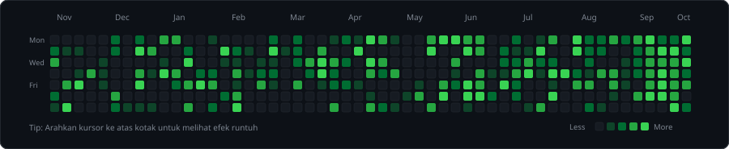
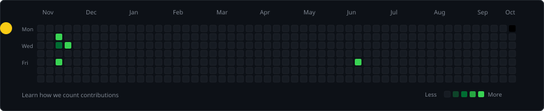

<picture>
  <source media="(prefers-color-scheme: dark)" srcset="./assets/banner-dark.svg">
  <source media="(prefers-color-scheme: light)" srcset="./assets/banner-light.svg">
  
</picture>

 
 

<a href="https://github.com/mamoy321">
  <picture>
    <source media="(prefers-color-scheme: dark)" srcset="https://readme-typing-svg.demolab.com?font=JetBrains+Mono&weight=600&size=19&duration=2800&pause=1000&color=38BDF8&center=true&vCenter=true&width=800&lines=%E2%96%B8+Linux+Sysadmin+%26+Network+Infrastructure+Specialist;%E2%96%B8+Ubuntu+Server+Hardening+%26+Service+Orchestration;%E2%96%B8+MikroTik+RouterOS+%26+VLAN+Subnetting+Architecture;%E2%96%B8+FTTH+Fiber+Optic+Splicing+%26+Field+Telecom+Tech;%E2%96%B8+Information+Systems+Student+%E2%80%A2+Based+in+Lampung%2C+ID">
    <source media="(prefers-color-scheme: light)" srcset="https://readme-typing-svg.demolab.com?font=JetBrains+Mono&weight=600&size=19&duration=2800&pause=1000&color=0284C7&center=true&vCenter=true&width=800&lines=%E2%96%B8+Linux+Sysadmin+%26+Network+Infrastructure+Specialist;%E2%96%B8+Ubuntu+Server+Hardening+%26+Service+Orchestration;%E2%96%B8+MikroTik+RouterOS+%26+VLAN+Subnetting+Architecture;%E2%96%B8+FTTH+Fiber+Optic+Splicing+%26+Field+Telecom+Tech;%E2%96%B8+Information+Systems+Student+%E2%80%A2+Based+in+Lampung%2C+ID">
    
  </picture>
</a>

 
 

 

---

  <picture>
    <source media="(prefers-color-scheme: dark)" srcset="./assets/whoami-dark.svg">
    <source media="(prefers-color-scheme: light)" srcset="./assets/whoami-light.svg">
    
  </picture>

 

---

  
<b>Core Operating Systems &amp; Network Infrastructure</b>

  <a href="https://skillicons.dev">
    <picture>
      <source media="(prefers-color-scheme: dark)" srcset="https://skillicons.dev/icons?i=ubuntu,debian,linux,bash,nginx,cisco,wireshark&theme=dark">
      <source media="(prefers-color-scheme: light)" srcset="https://skillicons.dev/icons?i=ubuntu,debian,linux,bash,nginx,cisco,wireshark&theme=light">
      
    </picture>
  </a>
   
   
  
<b>Web Development, Database &amp; Tooling</b>

  <a href="https://skillicons.dev">
    <picture>
      <source media="(prefers-color-scheme: dark)" srcset="https://skillicons.dev/icons?i=js,html,css,php,mysql,git,github,vscode&theme=dark">
      <source media="(prefers-color-scheme: light)" srcset="https://skillicons.dev/icons?i=js,html,css,php,mysql,git,github,vscode&theme=light">
      
    </picture>
  </a>

 

#### 1. Linux &amp; Server Administration

#### 2. Networking, Routing &amp; Telecom

#### 3. Physical Infrastructure &amp; Field Equipment

[-0891b2?style=flat-square&logo=gauge&logoColor=white)](https://github.com/mamoy321)

---

### 📂 Interactive Deep Dives

<b>⚡ 1. Infrastructure &amp; Server Lab Environment (Klik untuk membuka)</b>

 

* **Edge Routing &amp; Gateway**:
  * Pengelolaan perangkat MikroTik RouterOS untuk distribusi bandwidth kantor dan laboratorium.
  * Segmentasi network menggunakan VLAN 802.1Q dan inter-VLAN routing terisolasi.
  * Pengamanan port forwarding, firewall filtering, NAT masquerade, serta simple queue QoS.
* **Linux Server Cluster**:
  * Instalasi dan konfigurasi headless OS Ubuntu Server 24.04 LTS dan Debian.
  * Nginx web server deployment dengan reverse proxy, SSL/TLS certbot, dan cache tuning.
  * Resolusi nama domain lokal menggunakan BIND9 DNS server.
  * Otomasi backup basis data dan rotasi log terjadwal via Bash scripts dan cron service.
  * Penguatan keamanan SSH (key-based authentication, non-standard port, disabled root login).

<b>📡 2. Field ISP &amp; Telecommunications Experience (Klik untuk membuka)</b>

 

* **Fiber Optic Network (FTTH)**:
  * Penarikan dan instalasi kabel drop core dari Optical Distribution Point (ODP) ke lokasi pelanggan.
  * Penyambungan serat kaca menggunakan Optical Fusion Splicer dengan presisi redaman tinggi.
  * Audit level daya optik menggunakan Optical Power Meter (OPM) sesuai standar batas redaman aman (-18 dBm s.d. -23 dBm).
  * Terminasi konektor SC/UPC dan SC/APC pada Optical Termination Box (OTB) dan Roset.
* **CPE &amp; Wireless Link**:
  * Konfigurasi Optical Network Terminal (ONT / ONU) mode bridge maupun PPPoE dial-up.
  * Pengaturan access point wireless pelanggan untuk stabilitas jangkauan sinyal WiFi.
  * Pemasangan radio wireless outdoor 5.8 GHz Point-to-Point (PTP) untuk link transmisi data.

<b>🎓 3. Academic &amp; Vocational Background (Klik untuk membuka)</b>

 

* **Pendidikan Tinggi**: Mahasiswa Program Studi Sistem Informasi di Lampung (Fokus integrasi infrastruktur IT dengan sistem informasi).
* **Pendidikan Menengah Kejuruan**: SMK PGRI 2 Ponorogo - Jurusan Teknik Komputer dan Jaringan (TKJ).
* **Praktek Kerja Lapangan (PKL)**: Junior Network Technician (Penataan rak server, patch cord, crimping UTP/STP, pemeliharaan lab komputer).
* **Pekerjaan Lapangan**: Teknisi Jaringan Internet (Mitra ISP / Penyedia Jasa Internet) menangani instalasi, splicing fiber optik, dan perbaikan gangguan koneksi.

---

### 📊 GitHub Activity

  <table border="0">
    <tr>
      <td align="center" width="50%">
        <picture>
          <source media="(prefers-color-scheme: dark)" srcset="https://github-readme-stats.vercel.app/api?username=mamoy321&show_icons=true&theme=tokyonight&hide_border=true&bg_color=080d1a&title_color=38bdf8&text_color=94a3b8&icon_color=2563eb">
          <source media="(prefers-color-scheme: light)" srcset="https://github-readme-stats.vercel.app/api?username=mamoy321&show_icons=true&theme=default&hide_border=true&bg_color=ffffff&title_color=0284c7&text_color=334155&icon_color=0284c7">
          
        </picture>
      </td>
      <td align="center" width="50%">
        <picture>
          <source media="(prefers-color-scheme: dark)" srcset="https://github-readme-stats.vercel.app/api/top-langs/?username=mamoy321&layout=compact&theme=tokyonight&hide_border=true&bg_color=080d1a&title_color=38bdf8&text_color=94a3b8">
          <source media="(prefers-color-scheme: light)" srcset="https://github-readme-stats.vercel.app/api/top-langs/?username=mamoy321&layout=compact&theme=default&hide_border=true&bg_color=ffffff&title_color=0284c7&text_color=334155">
          
        </picture>
      </td>
    </tr>
  </table>
  
   
  
  <picture>
    <source media="(prefers-color-scheme: dark)" srcset="https://github-readme-streak-stats.herokuapp.com/?user=mamoy321&theme=tokyonight&hide_border=true&background=080d1a&ring=38bdf8&fire=38bdf8&currStreakLabel=38bdf8">
    <source media="(prefers-color-scheme: light)" srcset="https://github-readme-streak-stats.herokuapp.com/?user=mamoy321&theme=default&hide_border=true&background=ffffff&ring=0284c7&fire=ea580c&currStreakLabel=0284c7">
    
  </picture>

---

 

&nbsp;

 
 

 
 

<picture>
  <source media="(prefers-color-scheme: dark)" srcset="./assets/contributions-dark.svg">
  <source media="(prefers-color-scheme: light)" srcset="./assets/contributions-light.svg">
  
</picture>

 

<picture>
  <source media="(prefers-color-scheme: dark)" srcset="./assets/pacman-dark.svg">
  <source media="(prefers-color-scheme: light)" srcset="./assets/pacman-light.svg">
  
</picture>

